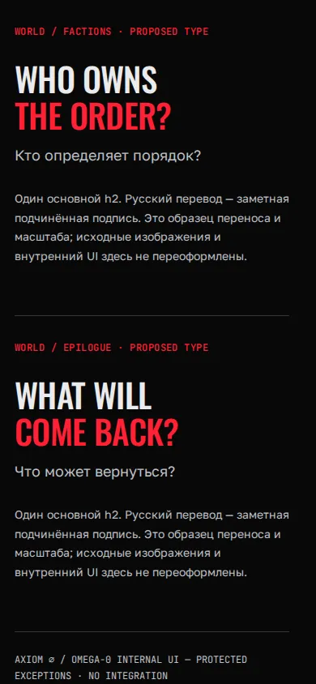

<!--
AXS_HEADER_META:
  id: AXS.SHOWCASE.0524.W4R.BILINGUAL_SPECIMENS
  title: "W4.R — seven bilingual heading specimens"
  status: R1_PROPOSED / NOT_INTEGRATED
  deployment: NOT_DEPLOYED
  lang: ru
  last_updated: 2026-10-21
  editable_by_agents: true
-->
# Семь основных ENG/RU тезисов

[Живой specimen](../../evidence/w4r/prototypes/headings.html) показывает весь набор, включая entry/factions/epilogue. Это типографический лист: он **не предлагает новую композицию W01**, не переносит старую карту и не меняет внутренний UI AXIOM∅/OMEGA. A/B/C показывают применение той же системы в разных сценах. Один h2, подчинённый p.translation, Oswald/Golos/Mono; utility labels не конкурируют с тезисом.

[Source hash,7 viewport bounds checks и14 native screenshots](../../evidence/w4r/heading-specimens.json). Проверены1920/1440/1366/1024/768/390/360; horizontal overflow/heading bounds без срабатываний. Native1440×900 и390×844/DPR1/RM; viewport может включать соседний образец, кадры не обрезаны/склеены. Это дополнительная R1 проверка typography, не R3 или actual200%. Воспроизведение: открыть standalone HTML в той же локальной Chromium149 установке, дождаться fonts.ready, установить указанный viewport и прокрутить к specimen id; оригинальные fonts.css/concepts.css должны сохраниться.

| Scene | Desktop native | Mobile native |
| --- | --- | --- |
| entry | [1440×900](../../evidence/w4r/captures/type-desktop-entry.webp) | [390×844](../../evidence/w4r/captures/type-mobile-entry.webp) |
| doctrine | [1440×900](../../evidence/w4r/captures/type-desktop-doctrine.webp) | [390×844](../../evidence/w4r/captures/type-mobile-doctrine.webp) |
| remains | [1440×900](../../evidence/w4r/captures/type-desktop-remains.webp) | [390×844](../../evidence/w4r/captures/type-mobile-remains.webp) |
| geography | [1440×900](../../evidence/w4r/captures/type-desktop-geography.webp) | [390×844](../../evidence/w4r/captures/type-mobile-geography.webp) |
| characters | [1440×900](../../evidence/w4r/captures/type-desktop-characters.webp) | [390×844](../../evidence/w4r/captures/type-mobile-characters.webp) |
| factions | [1440×900](../../evidence/w4r/captures/type-desktop-factions.webp) | [390×844](../../evidence/w4r/captures/type-mobile-factions.webp) |
| epilogue | [1440×900](../../evidence/w4r/captures/type-desktop-epilogue.webp) | [390×844](../../evidence/w4r/captures/type-mobile-epilogue.webp) |

R-A still PENDING; формы и переводы подлежат выбору CREATOR. Источники терминов и границы повествования — [Canon trace](R0_TERMINOLOGY_TRACE.md).
