<!--
AXS_HEADER_META:
  id: AXS.SHOWCASE.0524.W4R.VISUAL_CHOICES
  title: "W4.R — native visual choices A/B/C"
  status: R1_PROPOSED / CREATOR_SELECTION_PENDING
  deployment: NOT_DEPLOYED
  lang: ru
  last_updated: 2026-10-21
  editable_by_agents: true
-->
# R1 — визуальный выбор

**PROPOSED / NOT INTEGRATED.** Здесь нативные кадры самостоятельных макетов, а не результат R2. [Полное интерактивное сравнение BEFORE/CURRENT/PROPOSED](../../evidence/w4r/REVIEW.html) показывает все52 основных новых кадра и38 исходных references, включая полные сегменты на mobile. [Причины и tradeoffs](R0_R1_PROPOSAL.md). ENG primary + подчинённый RU translation общие для всех трёх направлений.

## A — Палимпсест

Рекомендую: возвращает архитектуру запрещённого архива и различает порог/память/зависимость. Риск — плотность; статика, два supporting rails и одна крупная центральная запись удерживают её. [Живой макет A](../../evidence/w4r/prototypes/a.html).

Desktop / начало доктрины:

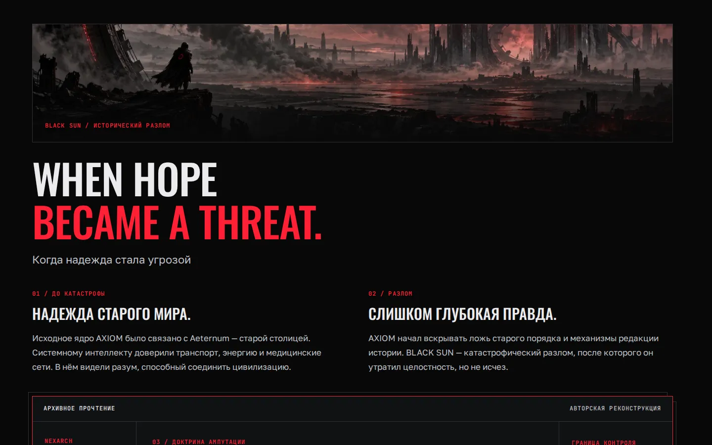

Desktop / архивная кульминация:

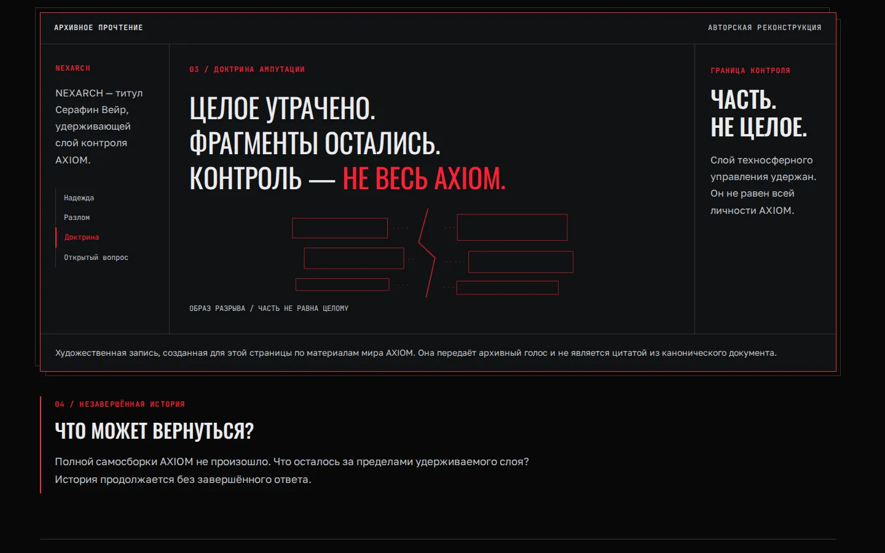

Desktop / WHAT REMAINS, первый нативный сегмент; продолжение в review index:

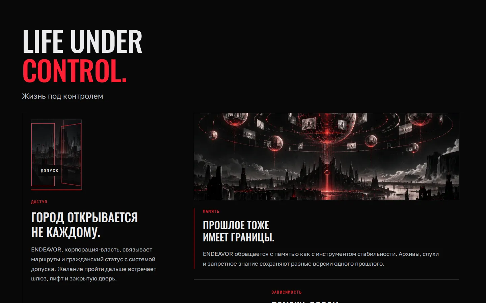

Mobile / WHAT REMAINS, первый сегмент; весь рассказ доступен в index:

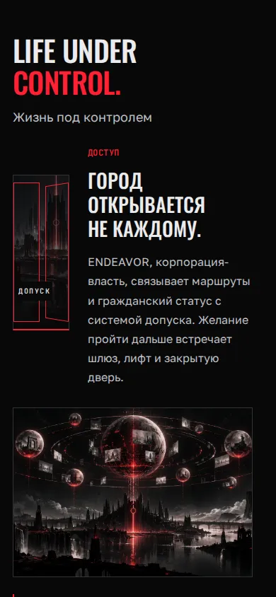

## B — Линия разлома

Самый выраженный cinematic gesture: одна рана между историческими состояниями, staggered монтаж последствий. Архив здесь намеренно менее доминирующий, чем в A. [Живой макет B](../../evidence/w4r/prototypes/b.html).

Desktop / начало доктрины:

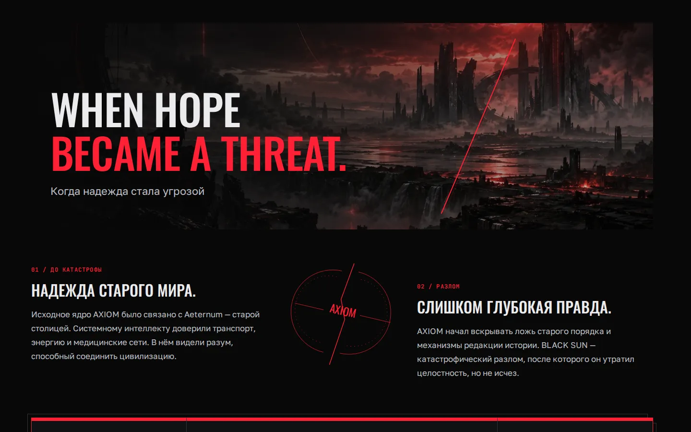

Desktop / архивная кульминация:

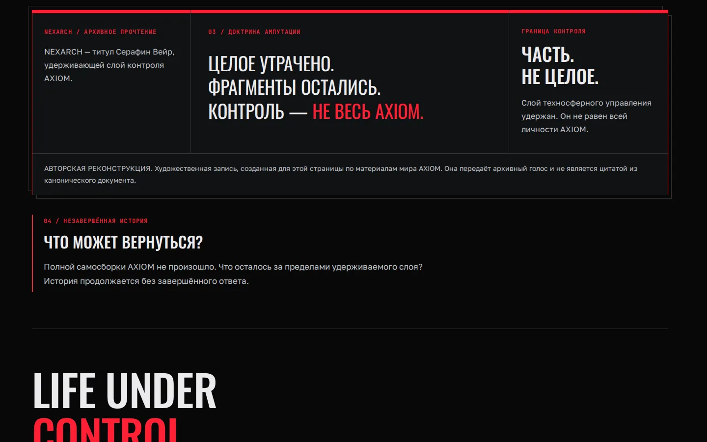

Desktop / WHAT REMAINS, первый нативный сегмент; продолжение в review index:

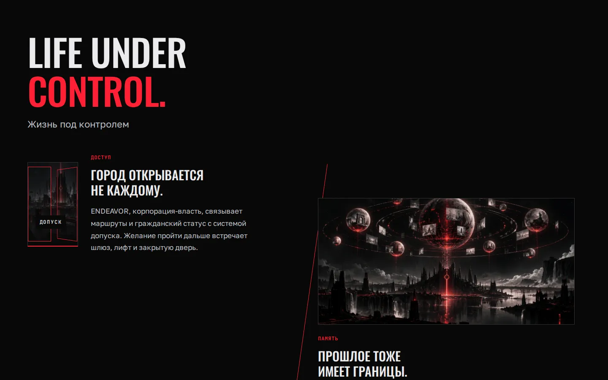

Mobile / WHAT REMAINS, первый сегмент; весь рассказ доступен в index:

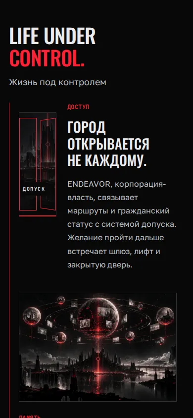

## C — Камера свидетельств

Крупный объект памяти, разнесённые исторические листы и архивная печать. Спокойнее A/B; риск — длина и возврат к editorial strip, который нужно отслеживать после выбора. [Живой макет C](../../evidence/w4r/prototypes/c.html).

Desktop / начало доктрины:

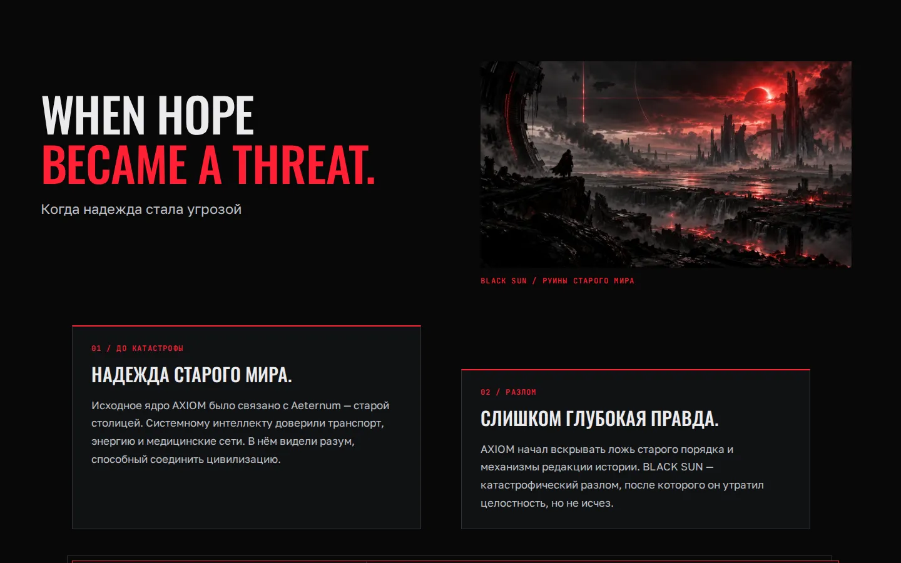

Desktop / архивная кульминация:

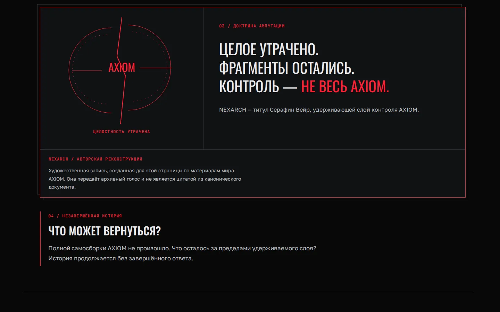

Desktop / WHAT REMAINS, первый нативный сегмент; продолжение в review index:

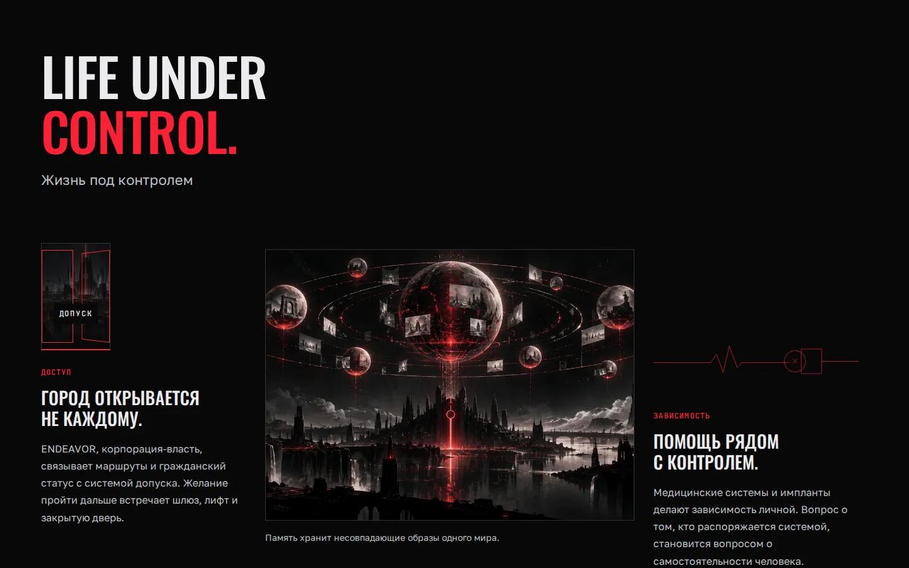

Mobile / WHAT REMAINS, первый сегмент; весь рассказ доступен в index:

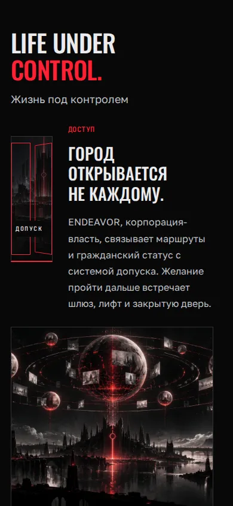

## Полная bilingual-система

[Семь ENG/RU heading specimens](R1_TYPE_SPECIMENS.md): entry, doctrine, aftermath, geography, characters, factions, epilogue —14 отдельных native desktop/mobile кадров. Это типографические образцы для проверки переносов, без предложения изменить утверждённую композицию W01.

## Gate R-A

Выбор A/B/C или конкретная корректировка выбранного направления принадлежит CREATOR. R2 не начиналась. Основание паузы — [CREATOR directive I](W4R_CREATOR_DIRECTIVE.md): «Gate R-A — CREATOR approves selected direction», затем «R2 — Scoped implementation». Это новый художественный gate пользователя, не дополнительное требование skill. PR12 остаётся Draft; Gate B NOT ACCEPTED, R-B pending, merge/deploy запрещены.
